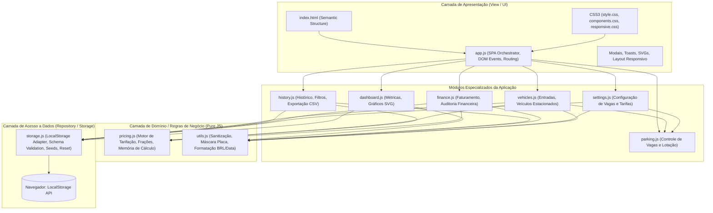
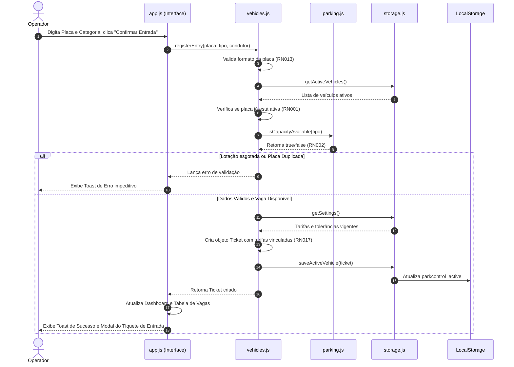
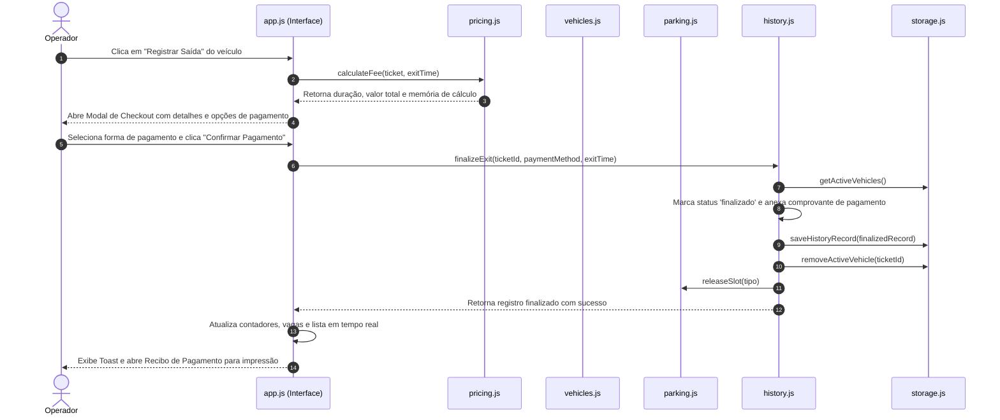

# DOCUMENTO DE ARQUITETURA DE SOFTWARE
## ParkControl — Sistema de Controle e Gerenciamento de Estacionamento

**Instituição:** Faculdade de Tecnologia de Carapicuíba — FATEC Carapicuíba  
**Curso:** Análise e Desenvolvimento de Sistemas (ADS Noite)  
**Ano:** 2026  
**Autores:** João Pedro Ribas da Silva & Nicolas Ferreira Souza  
**Versão:** 1.0.0  
**Data de Atualização:** Novembro de 2026  

---

### 1. Visão Geral da Arquitetura

O **ParkControl** foi arquitetado como uma aplicação web do tipo **Single Page Application (SPA)** puramente client-side, desenvolvida exclusivamente com **HTML5 semântico**, **CSS3 moderno** e **JavaScript Vanilla (ES6+)**. 

A arquitetura foi concebida sob rigorosos princípios de Engenharia de Software, priorizando:
- Alta coesão e baixo acoplamento entre os módulos.
- Desacoplamento estrito entre a lógica de negócio (cálculos tarifários, validação de regras, consistência de vagas) e a camada de apresentação (manipulação do DOM).
- Portabilidade total: o sistema roda em qualquer navegador moderno estaticamente, sem necessidade de servidores Node.js, transpiladores TypeScript, bundlers (Webpack/Vite) ou dependências de terceiros.
- Persistência desacoplada em camada de repositório abstraindo a API do `localStorage`.

---

### 2. Diagrama de Arquitetura em Camadas (Mermaid)

---

### 3. Organização e Responsabilidade dos Módulos

| Arquivo / Módulo | Camada | Responsabilidade Principal |
| :--- | :--- | :--- |
| **`index.html`** | Apresentação | Estrutura semântica da Single Page Application contendo sidebar de navegação, cabeçalho de status, áreas principais para cada tela (Dashboard, Entrada, Estacionados, Histórico, Financeiro, Configurações), templates de modais de saída e comprovante, e contêiner de notificações toast. |
| **`css/style.css`** | Estilo Base | Design tokens (variáveis CSS de cores, fontes, espaçamentos), reset CSS limpo, tipografia, estrutura da sidebar, cabeçalho e grid principal. |
| **`css/components.css`** | Componentes | Estilização de cards KPI, tabelas operacionais, badges de status, botões modernos, formulários, modais, recibos fiscais para tela/impressão (`@media print`) e notificações toast flutuantes. |
| **`css/responsive.css`** | Responsividade | Media queries para adaptação harmônica em dispositivos desktop, tablets e celulares, transformando a sidebar em menu expansível e reorganizando grids de cartões e tabelas. |
| **`js/utils.js`** | Utilitários | Funções auxiliares puras: sanitização de strings contra XSS (`escapeHTML`), validação e formatação de placas (antiga/Mercosul), formatação monetária padrão Real brasileiro (`Intl.NumberFormat`), formatação amigável de datas/horas e cálculo de diferença de tempo em minutos. |
| **`js/pricing.js`** | Lógica de Negócio | Motor tarifário puro: cálculo do tempo de permanência, validação da tolerância (RN007), cobrança da primeira hora (RN008), frações adicionais de 15 minutos a 25% (RN009), composição da memória de cálculo detalhada e cálculo de troco para pagamentos em dinheiro. |
| **`js/storage.js`** | Persistência | Abstração do `localStorage` com controle de integridade, versionamento de schema, inicialização das configurações padrão, leitura e escrita atômica, injeção de dados de demonstração (seed) e reset completo. |
| **`js/parking.js`** | Lógica de Negócio | Controle de capacidade e lotação: apuração de vagas ocupadas e disponíveis por categoria (carro/moto), cálculo da taxa percentual de ocupação e aplicação da regra de bloqueio por capacidade esgotada (RN002 e RN015). |
| **`js/vehicles.js`** | Controle Operacional | Gerenciamento de entradas e permanências ativas: criação de novos tíquetes, aplicação de identificador único (RN003), garantia de placa única ativa (RN001), vinculação da tarifa irretroativa no momento da entrada (RN017). |
| **`js/history.js`** | Controle Operacional | Gerenciamento do histórico de permanências concluídas: registro imutável pós-pagamento (RN012), filtragem multicritério (placa, tipo, intervalo de datas) e exportação dos dados filtrados para CSV com cabeçalho UTF-8 BOM (RF017). |
| **`js/finance.js`** | Controle Operacional | Consolidação das movimentações financeiras: cômputo de faturamento confirmado (RN010), segregação de receitas por método de pagamento (Dinheiro, Pix, Débito, Crédito) e apuração do tíquete médio. |
| **`js/settings.js`** | Configuração | Gestão dos parâmetros do estabelecimento: persistência de nomes, tarifas horárias, capacidades e tolerâncias, com verificação de segurança impedindo capacidades menores que a ocupação presente (RN015). |
| **`js/dashboard.js`** | Apresentação Analítica | Geração e renderização dos cartões de métricas em tempo real e montagem de gráficos vetoriais nativos em SVG para fluxo horário de veículos e composição de receitas, sem dependência de bibliotecas pesadas. |
| **`js/app.js`** | Orquestrador SPA | Inicialização do sistema, gerenciamento das abas ativas, captura de eventos de formulários, acionamento dos modais de checkout e de comprovante, despacho de notificações toast e loop de atualização em tempo real do pátio a cada segundo. |

---

### 4. Fluxo de Dados Operacional (Diagrama de Sequência)

#### 4.1. Fluxo de Entrada de Veículo

#### 4.2. Fluxo de Saída, Pagamento e Liberação de Vaga

---

### 5. Decisões Técnicas de Projeto

1. **Arquitetura Vanilla JS Modular sem Dependências:**
   - **Decisão:** Não utilizar frameworks SPA como React ou Vue nem bibliotecas externas de componentes ou gráficos (Chart.js).
   - **Justificativa:** Cumprimento rigoroso dos requisitos acadêmicos, eliminando etapas de build (`npm build`) e garantindo carregamento instantâneo, leveza extraordinária (< 250KB total com ícones) e compreensão didática absoluta de cada linha de código.
2. **Gráficos em SVG Puro Desenvolvidos Sob Medida:**
   - **Decisão:** Renderização de gráficos de barras e distribuição diretamente com elementos `<svg>` nativos construídos dinamicamente via JavaScript.
   - **Justificativa:** Garantia de total independência de CDNs externas, funcionamento offline impecável e estética customizada de acordo com a paleta de cores corporativa do projeto.
3. **Persistência via LocalStorage com Camada Abstrata de Repositório:**
   - **Decisão:** Isolar todas as chamadas `getItem`/`setItem` dentro de `storage.js`, encapsulando parsing com `JSON.parse` seguro e validação de schema.
   - **Justificativa:** Permite que no futuro a camada de armazenamento seja facilmente substituída por chamadas assíncronas `fetch()` para uma API REST com banco relacional sem necessidade de alterar as interfaces ou as regras de negócio.
4. **Sanitização Proativa Contra XSS:**
   - **Decisão:** Criação e uso sistemático do método `escapeHTML` em todas as interpolações de dados informados pelo usuário antes da inserção no DOM.
   - **Justificativa:** Segurança fundamental em aplicações web, impedindo ataques de injeção de scripts maliciosos.

---

### 6. Limitações Conhecidas do Protótipo Acadêmico

- **Armazenamento no Navegador (Client-side):** O `localStorage` é vinculado à origem e ao navegador local da máquina executora. Os dados não sincronizam automaticamente entre múltiplos computadores ou operadores remotos simultâneos.
- **Segurança e Criptografia:** Como protótipo acadêmico sem backend, não há autenticação JWT/OAuth2 com controle de senhas de operadores nem proteção contra inspeção manual de dados via DevTools do navegador.
- **Transações Financeiras Demonstrativas:** O fluxo de pagamento emite tíquetes e recibos de forma fidedigna ao processo comercial, porém não integra transações de débito/crédito reais com adquirentes nem gera QR Codes Pix com o Banco Central.
