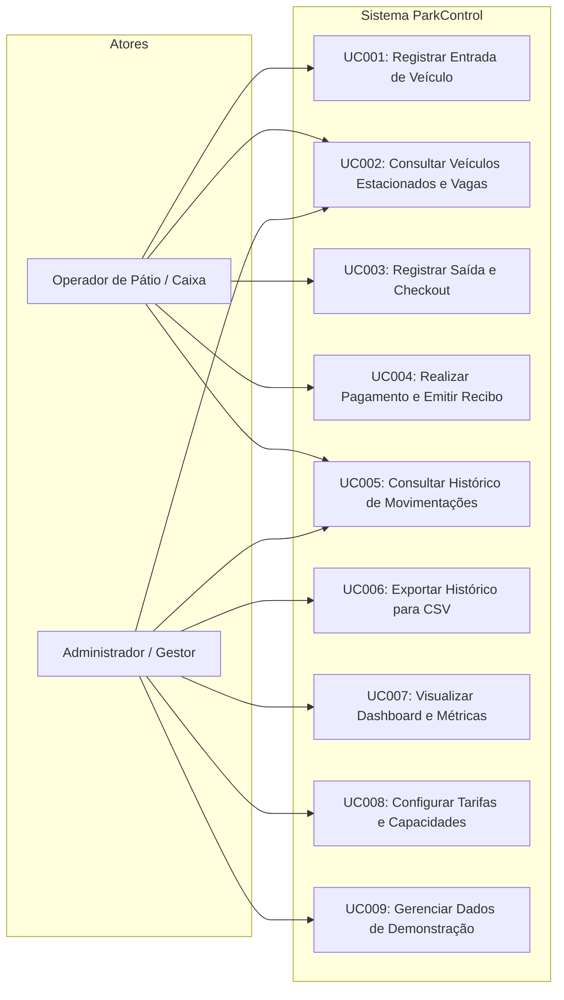

# ESPECIFICAÇÃO DE CASOS DE USO
## ParkControl — Sistema de Controle e Gerenciamento de Estacionamento

**Instituição:** Faculdade de Tecnologia de Carapicuíba — FATEC Carapicuíba  
**Curso:** Análise e Desenvolvimento de Sistemas (ADS Noite)  
**Ano:** 2026  
**Autores:** João Pedro Ribas da Silva & Nicolas Ferreira Souza  
**Versão:** 1.0.0  
**Data de Atualização:** Novembro de 2026  

---

### 1. Diagrama Geral de Casos de Uso (Mermaid)

---

### 2. Especificação Textual dos Casos de Uso

---

#### UC001 — Registrar Entrada de Veículo
- **Identificador:** UC001
- **Nome:** Registrar Entrada de Veículo
- **Ator principal:** Operador de Pátio / Caixa
- **Objetivo:** Registrar o ingresso de um veículo no estabelecimento, associando seus dados e iniciando a contagem de permanência.
- **Pré-condições:**
  1. O sistema deve estar carregado e operacional.
  2. Deve haver ao menos uma vaga disponível para a categoria do veículo (carro ou moto).
- **Fluxo Principal:**
  1. O operador navega até a aba/tela "Entrada de Veículos".
  2. O operador digita a placa do veículo no campo correspondente.
  3. O operador seleciona o tipo do veículo (Carro ou Moto).
  4. Opcionalmente, o operador preenche o nome do condutor/responsável.
  5. O operador confere a data e hora sugeridas automaticamente pelo sistema.
  6. O operador clica no botão "Confirmar Entrada".
  7. O sistema valida os dados informados, a inexistência de duplicidade de placa ativa e a disponibilidade de vaga.
  8. O sistema gera o identificador único do tíquete e anexa as tarifas vigentes.
  9. O sistema persiste a nova permanência no `localStorage`.
  10. O sistema decrementa a contagem de vagas disponíveis do respectivo tipo.
  11. O sistema exibe um toast de sucesso e abre o modal do tíquete de entrada com opção para impressão.
  12. O formulário é limpo e preparado para a próxima entrada.
- **Fluxos Alternativos:**
  - **FA01 — Ajuste manual do horário de entrada:** No passo 5, o operador pode editar o horário caso o veículo tenha entrado há alguns minutos durante queda temporária de energia ou fila na cancela.
- **Exceções:**
  - **EX01 — Placa já ativa no pátio (RN001):** No passo 7, se a placa informada já possuir status ativo, o sistema exibe notificação de erro: *"Veículo com placa [PLACA] já está com permanência ativa no pátio."* O registro é abortado.
  - **EX02 — Estacionamento lotado para o tipo (RN002):** No passo 7, se as vagas para a categoria escolhida estiverem esgotadas, o sistema exibe alerta visual: *"Capacidade esgotada para [TIPO]. Não é possível realizar novas entradas."* O registro é impedido.
  - **EX03 — Formato de placa inválido (RN013):** No passo 7, se a placa não atender ao padrão antigo (`AAA-9999`) ou Mercosul (`AAA9A99`), o sistema destaca o campo em vermelho com mensagem: *"Placa inválida. Utilize o formato brasileiro tradicional ou Mercosul."*
- **Pós-condições:** O veículo consta na lista de veículos ativos, as vagas ocupadas aumentam em 1 e os dados persistem em armazenamento local.

---

#### UC002 — Consultar Veículos Estacionados e Vagas
- **Identificador:** UC002
- **Nome:** Consultar Veículos Estacionados e Vagas
- **Ator principal:** Operador de Pátio / Caixa, Administrador
- **Objetivo:** Obter a lista em tempo real de todos os veículos que ocupam vagas, visualizando o tempo decorrido e o valor financeiro estimado acumulado.
- **Pré-condições:** O sistema estar em execução.
- **Fluxo Principal:**
  1. O usuário clica na aba "Estacionados".
  2. O sistema recupera todas as permanências ativas persistidas.
  3. Para cada registro, o sistema calcula a diferença entre o horário atual e o horário de entrada.
  4. O sistema aplica o motor de tarifação sobre os minutos decorridos e projeta o valor estimado devido.
  5. A tabela é renderizada exibindo: Placa, Categoria, Data/Hora Entrada, Tempo Decorrido, Valor Estimado e Botões de Ação.
  6. Um timer em background atualiza os contadores de tempo e valores a cada minuto sem intervenção do operador.
- **Fluxos Alternativos:**
  - **FA01 — Filtragem por placa ou tipo:** O usuário digita uma placa na barra de pesquisa ou seleciona o filtro "Carros" / "Motos"; a tabela filtra instantaneamente as linhas correspondentes.
- **Exceções:**
  - **EX01 — Pátio vazio:** Se não houver nenhum veículo ativo, o sistema renderiza um estado vazio (*empty state*) elegante com ícone informativo e mensagem convidando a registrar uma nova entrada.
- **Pós-condições:** Nenhuma alteração no estado persistido.

---

#### UC003 — Registrar Saída e Checkout
- **Identificador:** UC003
- **Nome:** Registrar Saída e Checkout
- **Ator principal:** Operador de Pátio / Caixa
- **Objetivo:** Iniciar o encerramento da permanência do veículo, exibir a memória descritiva do cálculo tarifário e preparar para a cobrança.
- **Pré-condições:** O veículo deve estar com uma permanência com status 'ativo' no sistema.
- **Fluxo Principal:**
  1. O operador localiza o veículo na lista de estacionados ou digita a placa no atalho de saída rápida.
  2. O operador clica no botão "Registrar Saída".
  3. O sistema abre o modal de checkout com os dados do veículo e da estadia:
     - Placa e tipo;
     - Horário de entrada e horário de saída sugerido (momento atual);
     - Tempo total decorrido;
     - Memória de cálculo detalhada (se houve tolerância, primeira hora ou frações de 15 min);
     - Valor total a pagar destacado.
  4. O operador seleciona a forma de pagamento desejada.
  5. Segue para a confirmação (conforme UC004).
- **Fluxos Alternativos:**
  - **FA01 — Ajuste do horário de saída:** Caso haja tolerância manual de caixa, o operador pode definir o horário de saída; o sistema recalcula instantaneamente os minutos e a tarifa devida.
- **Exceções:**
  - **EX01 — Saída com horário anterior à entrada (RN014):** Se o operador informar um horário anterior à entrada, o sistema bloqueia o cálculo exibindo mensagem de data/hora inconsistente.
- **Pós-condições:** O modal de liquidação financeira é exibido na tela.

---

#### UC004 — Realizar Pagamento e Emitir Recibo
- **Identificador:** UC004
- **Nome:** Realizar Pagamento e Emitir Recibo
- **Ator principal:** Operador de Pátio / Caixa
- **Objetivo:** Confirmar a quitação dos valores devidos, liberar a vaga ocupada, mover a permanência para o histórico e gerar o comprovante fiscal/térmico.
- **Pré-condições:** Modal de checkout aberto com permanência ativa e valor calculado.
- **Fluxo Principal:**
  1. O operador seleciona a forma de pagamento (Dinheiro, Pix, Cartão de Débito ou Cartão de Crédito).
  2. Se selecionado "Dinheiro", o operador digita o montante em dinheiro entregue pelo cliente; o sistema calcula e exibe automaticamente o valor do troco.
  3. O operador clica no botão "Confirmar Pagamento e Liberar Saída".
  4. O sistema valida os dados do pagamento e marca a permanência como 'finalizada'.
  5. O sistema grava o registro financeiro na coleção de histórico com timestamp de liquidação e forma de pagamento.
  6. O sistema remove a permanência da lista de ativos e incrementa o saldo de vagas disponíveis do tipo do veículo.
  7. O sistema exibe um toast de sucesso e abre a tela de Comprovante de Pagamento (Recibo).
  8. O operador pode clicar em "Imprimir Comprovante" para disparar a janela nativa de impressão com layout de recibo otimizado.
- **Fluxos Alternativos:**
  - **FA01 — Saída dentro da tolerância (valor zerado):** Se a permanência for $\le 10$ minutos, o valor é R$ 0,00; a opção de pagamento fica automaticamente como "Isento / Tolerância" e a liberação é efetuada sem cobrança de valores.
- **Exceções:**
  - **EX01 — Valor entregue em dinheiro insuficiente:** O sistema desabilita a confirmação e exibe aviso de que o valor recebido é menor que o valor total devido.
- **Pós-condições:** Vaga liberada, faturamento do dia incrementado, permanência salva no histórico imutável.

---

#### UC005 — Consultar Histórico de Movimentações
- **Identificador:** UC005
- **Nome:** Consultar Histórico de Movimentações
- **Ator principal:** Operador de Pátio / Caixa, Administrador
- **Objetivo:** Auditar todas as permanências passadas já encerradas e quitadas.
- **Pré-condições:** O sistema estar carregado.
- **Fluxo Principal:**
  1. O usuário acessa a aba "Histórico".
  2. O sistema recupera a lista de permanências finalizadas e as ordena da mais recente para a mais antiga.
  3. O usuário visualiza as colunas: Placa, Tipo, Horário Entrada, Horário Saída, Tempo Total, Valor Pago, Método de Pagamento e Ação de Reimprimir.
  4. O usuário pode filtrar a lista preenchendo a busca por placa, selecionando o tipo de veículo ou especificando um intervalo de datas (Data Inicial / Data Final).
  5. A lista é atualizada instantaneamente respeitando os critérios de filtro.
- **Fluxos Alternativos:**
  - **FA01 — Reimprimir comprovante passado:** O operador clica no botão de ação "Ver Recibo" de qualquer linha histórica; o sistema abre o modal com o recibo original arquivado para nova impressão.
- **Exceções:**
  - **EX01 — Nenhum registro encontrado:** O sistema informa visualmente que não há movimentações correspondentes aos filtros aplicados.
- **Pós-condições:** Nenhuma alteração no estado persistido.

---

#### UC006 — Exportar Histórico para CSV
- **Identificador:** UC006
- **Nome:** Exportar Histórico para CSV
- **Ator principal:** Administrador, Operador
- **Objetivo:** Exportar os registros de movimentações finalizadas para arquivo tabular compatível com Excel e ferramentas de BI.
- **Pré-condições:** Existir ao menos um registro no histórico.
- **Fluxo Principal:**
  1. Na aba "Histórico", o usuário clica no botão "Exportar CSV".
  2. O sistema processa os registros (respeitando os filtros ativos aplicados em tela).
  3. O sistema monta a matriz CSV contendo cabeçalhos amigáveis em português: `ID;Placa;Tipo;Entrada;Saida;Duracao_Minutos;Duracao_Formatada;Valor_Cobrado_BRL;Metodo_Pagamento;Status;Data_Registro`.
  4. O sistema adiciona o BOM UTF-8 (`\uFEFF`) para evitar problemas de caracteres especiais e acentos no Microsoft Excel.
  5. O navegador dispara o download de um arquivo denominado `parkcontrol_historico_[TIMESTAMP].csv`.
  6. O sistema emite notificação de sucesso informando o término da exportação.
- **Exceções:**
  - **EX01 — Histórico vazio:** Se não houver nenhum registro a ser exportado, o sistema alerta: *"Não há movimentações para exportar no período selecionado."*
- **Pós-condições:** Arquivo físico baixado no dispositivo do usuário.

---

#### UC007 — Visualizar Dashboard e Métricas
- **Identificador:** UC007
- **Nome:** Visualizar Dashboard e Métricas
- **Ator principal:** Administrador, Operador
- **Objetivo:** Ter uma visão sintética e em tempo real dos principais indicadores operacionais e financeiros da operação.
- **Pré-condições:** O sistema estar em execução.
- **Fluxo Principal:**
  1. O usuário acessa a aba "Dashboard".
  2. O sistema calcula dinamicamente:
     - Total de vagas e distribuição de vagas livres/ocupadas para carros e motos;
     - Taxa percentual de ocupação global;
     - Entradas registradas na data de hoje;
     - Saídas registradas na data de hoje;
     - Faturamento total confirmado na data de hoje.
  3. O sistema renderiza os cards de KPI com ícones e cores temáticas.
  4. O sistema gera os gráficos em SVG nativo:
     - Gráfico de barras com movimentações por faixa horária;
     - Gráfico demonstrativo de faturamento.
  5. O sistema exibe o painel de movimentações recentes com links rápidos para ação.
- **Pós-condições:** Nenhuma modificação no estado persistido.

---

#### UC008 — Configurar Tarifas e Capacidades
- **Identificador:** UC008
- **Nome:** Configurar Tarifas e Capacidades
- **Ator principal:** Administrador
- **Objetivo:** Parametrizar as características operacionais do estacionamento: capacidades físicas por categoria, tarifas horárias, tolerâncias e frações.
- **Pré-condições:** O administrador ter acessado a aba "Configurações".
- **Fluxo Principal:**
  1. O administrador acessa a tela de "Configurações".
  2. O formulário exibe os parâmetros correntes persistidos.
  3. O administrador altera os campos desejados (ex: Nome do Estacionamento, Vagas de Carros, Vagas de Motos, Valor Hora Carro, Valor Hora Moto, Tolerância em minutos, Fração em minutos).
  4. O administrador clica em "Salvar Configurações".
  5. O sistema valida que nenhum valor seja negativo ou zerado incorretamente.
  6. O sistema valida se as novas capacidades de carros e motos não são inferiores à quantidade de veículos de cada tipo atualmente estacionados (RN015).
  7. O sistema persiste as novas configurações no `localStorage`.
  8. O sistema exibe notificação de confirmação e atualiza imediatamente os cálculos globais de vagas.
- **Exceções:**
  - **EX01 — Tentativa de reduzir capacidade abaixo da ocupação (RN015):** O sistema aborta o salvamento e exibe mensagem de erro impeditiva.
  - **EX02 — Valores monetários ou tempos inválidos:** O sistema rejeita o salvamento com alerta visual no campo com inconsistência.
- **Pós-condições:** Configurações atualizadas para novas operações.

---

#### UC009 — Gerenciar Dados de Demonstração (Seed / Reset)
- **Identificador:** UC009
- **Nome:** Gerenciar Dados de Demonstração (Seed / Reset)
- **Ator principal:** Avaliador Acadêmico / Administrador
- **Objetivo:** Popular a base com dados realistas pré-formatados para avaliação de bancas acadêmicas ou redefinir a base para estado limpo.
- **Pré-condições:** Estar na aba "Configurações" ou clicar no botão de demonstração no cabeçalho/dashboard.
- **Fluxo Principal (Carga de Demonstração):**
  1. O usuário clica em "Carregar Dados de Demonstração".
  2. Um modal de confirmação solicita o aval do usuário.
  3. O sistema injeta um conjunto coerente de dados contendo veículos ativos (com diferentes tempos de estadia) e movimentações finalizadas variadas do dia corrente.
  4. A página sincroniza o estado e redireciona ao Dashboard demonstrando os gráficos e cards preenchidos.
- **Fluxo Alternativo (Limpeza / Reset de Fábrica):**
  1. O usuário clica em "Limpar Todos os Dados (Reset)".
  2. Um modal de segurança solicita confirmação explícita da operação destrutiva.
  3. O sistema remove as chaves operacionais do `localStorage` e recria a configuração padrão.
  4. O sistema emite notificação e atualiza todas as visualizações para o estado vazio.
- **Pós-condições:** LocalStorage populado com massa de dados de teste ou redefinido para o padrão inicial.

