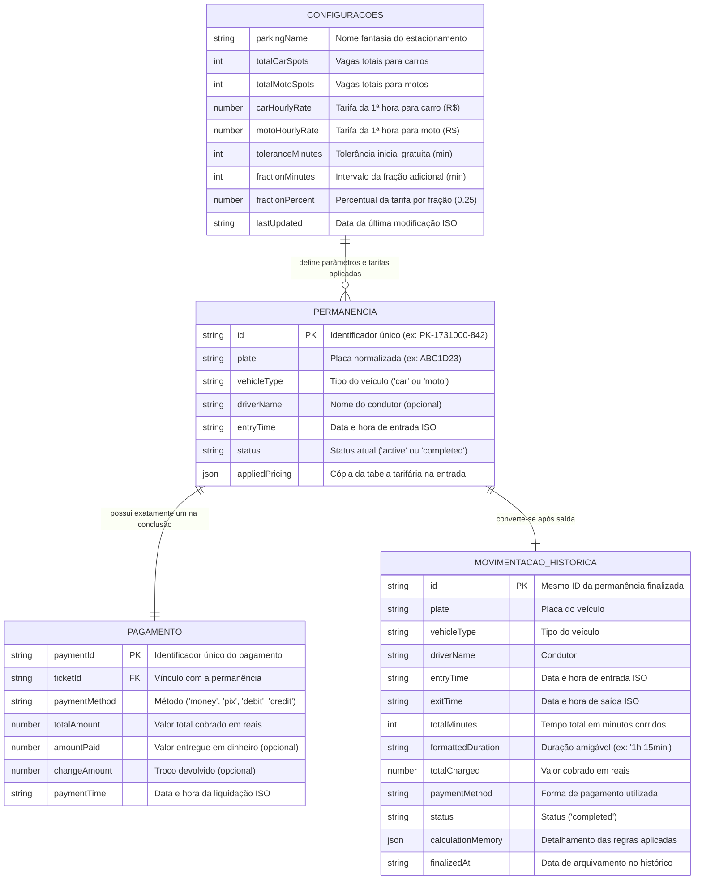

# MODELO DE DADOS E ENTIDADES
## ParkControl — Sistema de Controle e Gerenciamento de Estacionamento

**Instituição:** Faculdade de Tecnologia de Carapicuíba — FATEC Carapicuíba  
**Curso:** Análise e Desenvolvimento de Sistemas (ADS Noite)  
**Ano:** 2026  
**Autores:** João Pedro Ribas da Silva & Nicolas Ferreira Souza  
**Versão:** 1.0.0  
**Data de Atualização:** Novembro de 2026  

---

### 1. Visão Geral
Este documento especifica as estruturas de dados, tipos primitivos, restrições e relacionamentos lógicos que compõem o estado da aplicação **ParkControl**. Como o protótipo utiliza persistência em cliente via `localStorage`, os modelos são serializados em objetos e coleções JSON sob chaves com namespace explícito.

---

### 2. Diagrama Entidade-Relacionamento Lógico (Mermaid)



---

### 3. Dicionário de Dados das Entidades

#### 3.1. Entidade: `Settings` (Configurações do Estacionamento)
- **Chave de Persistência:** `parkcontrol_settings`
- **Cardinalidade:** Registro único (*Singleton*)

| Campo | Tipo | Obrigatório? | Descrição | Exemplo |
| :--- | :--- | :--- | :--- | :--- |
| `parkingName` | `string` | Sim | Nome comercial do estacionamento exibido no topo e nos comprovantes. | `"ParkControl Matriz"` |
| `totalCarSpots` | `number` | Sim | Capacidade total de vagas destinadas exclusivamente a automóveis. | `20` |
| `totalMotoSpots` | `number` | Sim | Capacidade total de vagas destinadas exclusivamente a motocicletas. | `10` |
| `carHourlyRate` | `number` | Sim | Tarifa base da 1ª hora para automóveis em reais (R$). | `10.00` |
| `motoHourlyRate` | `number` | Sim | Tarifa base da 1ª hora para motocicletas em reais (R$). | `5.00` |
| `toleranceMinutes`| `number` | Sim | Minutos iniciais com isenção total de cobrança (RN007). | `10` |
| `fractionMinutes` | `number` | Sim | Duração de cada bloco de fração após a 1ª hora (RN009). | `15` |
| `fractionPercent` | `number` | Sim | Percentual aplicado sobre a tarifa horária a cada fração iniciada. | `0.25` |
| `lastUpdated` | `string` | Sim | Data e hora ISO da última alteração de parâmetros. | `"2026-11-07T14:30:00.000Z"` |

#### 3.2. Entidade: `ActiveTicket` (Permanência Ativa / Veículo no Pátio)
- **Chave de Persistência:** `parkcontrol_active`
- **Cardinalidade:** Lista de 0 a $N$ veículos atualmente estacionados

| Campo | Tipo | Obrigatório? | Descrição | Exemplo |
| :--- | :--- | :--- | :--- | :--- |
| `id` | `string` | Sim | Chave primária única gerada com prefixo `PK-` e timestamp. | `"PK-1731002345000-412"` |
| `plate` | `string` | Sim | Placa do veículo normalizada em maiúsculas sem espaços. | `"BRA2E19"` |
| `vehicleType` | `string` | Sim | Categoria do veículo (`"car"` ou `"moto"`). | `"car"` |
| `driverName` | `string` | Não | Nome do condutor ou empresa responsável. | `"Carlos Eduardo"` |
| `entryTime` | `string` | Sim | Data e hora de entrada em formato ISO 8601. | `"2026-11-07T10:15:00.000Z"` |
| `status` | `string` | Sim | Estado da estadia: fixado em `"active"` enquanto no pátio. | `"active"` |
| `appliedPricing`| `object` | Sim | Cópia estática das tarifas vigentes no momento do registro (RN017). | `{ carRate: 10.0, motoRate: 5.0, tolerance: 10, fractionMin: 15, fractionPct: 0.25 }` |

#### 3.3. Entidade: `HistoryRecord` (Movimentação Finalizada / Histórico)
- **Chave de Persistência:** `parkcontrol_history`
- **Cardinalidade:** Coleção de 0 a $N$ movimentações encerradas

| Campo | Tipo | Obrigatório? | Descrição | Exemplo |
| :--- | :--- | :--- | :--- | :--- |
| `id` | `string` | Sim | Identificador mantido da permanência de origem. | `"PK-1731002345000-412"` |
| `plate` | `string` | Sim | Placa do veículo. | `"BRA2E19"` |
| `vehicleType` | `string` | Sim | Categoria (`"car"` ou `"moto"`). | `"car"` |
| `driverName` | `string` | Não | Nome do condutor. | `"Carlos Eduardo"` |
| `entryTime` | `string` | Sim | Data e hora de entrada (ISO 8601). | `"2026-11-07T10:15:00.000Z"` |
| `exitTime` | `string` | Sim | Data e hora de saída (ISO 8601). | `"2026-11-07T11:45:00.000Z"` |
| `totalMinutes` | `number` | Sim | Total de minutos corridos de estadia. | `90` |
| `formattedDuration`| `string`| Sim | Representação amigável da duração para exibição. | `"1h 30min"` |
| `totalCharged` | `number` | Sim | Valor cobrado e quitado em reais. | `15.00` |
| `paymentMethod` | `string` | Sim | Método (`"money"`, `"pix"`, `"debit"`, `"credit"`, `"tolerance"`). | `"pix"` |
| `status` | `string` | Sim | Estado final: `"completed"`. | `"completed"` |
| `calculationMemory`| `object`| Sim | Objeto descritivo com tolerância, frações apuradas e detalhamento. | *(Ver exemplo JSON abaixo)* |
| `finalizedAt` | `string` | Sim | Timestamp de arquivamento no histórico. | `"2026-11-07T11:45:10.000Z"` |

---

### 4. Exemplos Práticos de Objetos JSON

#### 4.1. Exemplo do Objeto de Configurações (`Settings`)
```json
{
  "parkingName": "ParkControl Central",
  "totalCarSpots": 25,
  "totalMotoSpots": 15,
  "carHourlyRate": 10.00,
  "motoHourlyRate": 5.00,
  "toleranceMinutes": 10,
  "fractionMinutes": 15,
  "fractionPercent": 0.25,
  "lastUpdated": "2026-11-07T14:00:00.000Z"
}
```

#### 4.2. Exemplo de Registro Ativo (`ActiveTicket`)
```json
{
  "id": "PK-1731001200000-781",
  "plate": "ABC1D23",
  "vehicleType": "car",
  "driverName": "Juliana Silveira",
  "entryTime": "2026-11-07T13:40:00.000Z",
  "status": "active",
  "appliedPricing": {
    "hourlyRate": 10.00,
    "toleranceMinutes": 10,
    "fractionMinutes": 15,
    "fractionPercent": 0.25
  }
}
```

#### 4.3. Exemplo de Registro de Histórico com Pagamento (`HistoryRecord`)
```json
{
  "id": "PK-1731001200000-781",
  "plate": "ABC1D23",
  "vehicleType": "car",
  "driverName": "Juliana Silveira",
  "entryTime": "2026-11-07T13:40:00.000Z",
  "exitTime": "2026-11-07T15:00:00.000Z",
  "totalMinutes": 80,
  "formattedDuration": "1h 20min",
  "totalCharged": 15.00,
  "payment": {
    "paymentId": "PAY-1731006000-992",
    "method": "pix",
    "methodLabel": "Pix",
    "amountPaid": 15.00,
    "changeAmount": 0.00,
    "paymentTime": "2026-11-07T15:00:15.000Z"
  },
  "status": "completed",
  "calculationMemory": {
    "withinTolerance": false,
    "firstHourApplied": true,
    "firstHourAmount": 10.00,
    "excessMinutes": 20,
    "fractionsCharged": 2,
    "fractionUnitRate": 2.50,
    "fractionTotalAmount": 5.00,
    "totalAmount": 15.00,
    "summary": "1ª Hora (R$ 10,00) + 2 frações de 15 min (R$ 5,00)"
  },
  "finalizedAt": "2026-11-07T15:00:15.000Z"
}
```

---

### 5. Validação e Integridade dos Dados
O módulo `storage.js` realiza verificações de tipos e saneamento básico no carregamento de cada registro. Caso algum dado no `localStorage` seja corrompido ou apresente inconsistências (ex: campos ausentes ou valores monetários negativos), o sistema adota valores padrão seguros e emite aviso em console, preservando a integridade da aplicação.
